# Домашнее задание к занятию «Запуск приложений в K8S» - Петр Петров

### Задание 1: Создать Deployment и обеспечить доступ к репликам приложения из другого Pod

1. Создать Deployment приложения, состоящего из двух контейнеров — nginx и multitool. Решить возникшую ошибку.
2. После запуска увеличить количество реплик работающего приложения до 2.
3. Продемонстрировать количество подов до и после масштабирования.
4. Создать Service, который обеспечит доступ до реплик приложений из п.1.
5. Создать отдельный Pod с приложением multitool и убедиться с помощью curl, что из пода есть доступ до приложений из п.1.

### Решение 1
Первоначальный запуск Deployment nginx-multitool. Один из двух контейнеров завершается с ошибкой, поэтому Pod не переходит в состояние Ready.

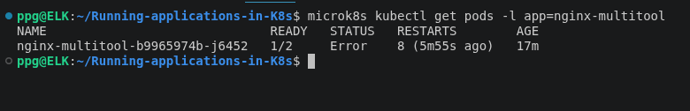

Устранение конфликта портов. Порты веб-сервера multitool изменены на 1180 и 11443. Оба контейнера успешно работают в одном Pod.

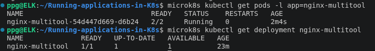

Масштабирование Deployment nginx-multitool. Количество реплик увеличено с одной до двух. Kubernetes создал второй Pod, в каждом Pod работают контейнеры nginx и multitool

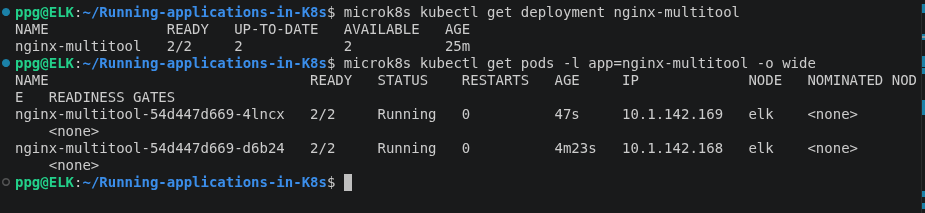

Service и подключение двух реплик. Создан Service типа ClusterIP, который направляет запросы на порт 80. Оба Pod зарегистрированы как endpoints

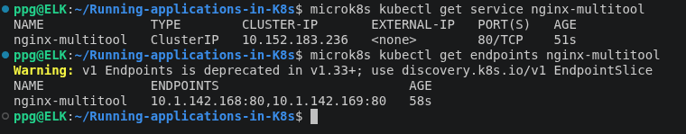

Проверка доступности приложения через Service. Тестовый Pod multitool-test успешно выполнил HTTP-запрос к Service nginx-multitool и получил ответ 200 OK. Это подтверждает доступность приложения по DNS-имени Service внутри кластера Kubernetes.

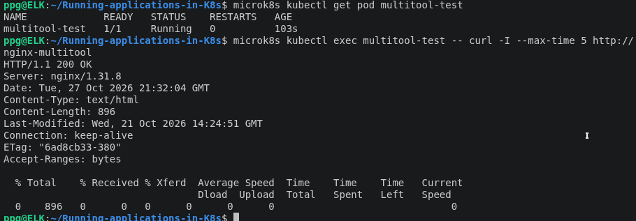

### Задание 2:Создать Deployment и обеспечить старт основного контейнера при выполнении условий

1. Создать Deployment приложения nginx и обеспечить старт контейнера только после того, как будет запущен сервис этого приложения.
2. Убедиться, что nginx не стартует. В качестве Init-контейнера взять busybox.
3. Создать и запустить Service. Убедиться, что Init запустился.
4. Продемонстрировать состояние пода до и после запуска сервиса. 

### Решение 2

Ожидание Service с помощью Init Container. Init Container wait-for-service на базе BusyBox проверяет наличие DNS-имени nginx-init. До создания Service DNS возвращает NXDOMAIN, Init Container продолжает ожидание, а основной контейнер Nginx остаётся в состоянии PodInitializing.

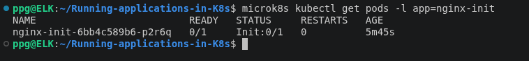

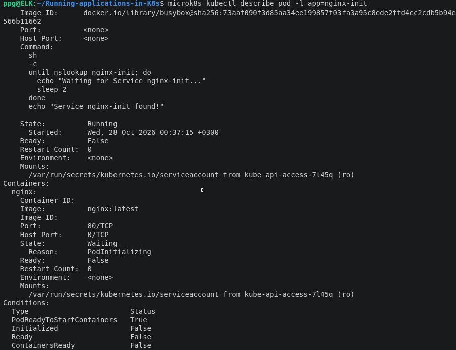

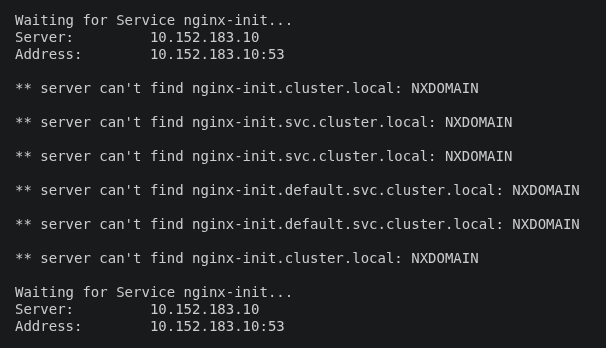

Запуск Nginx после создания Service. Init Container на базе BusyBox проверяет доступность DNS-имени Service. После его обнаружения Init Container завершается, и Kubernetes запускает основной контейнер Nginx.

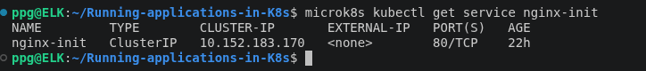

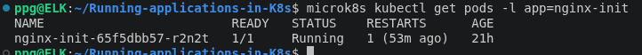

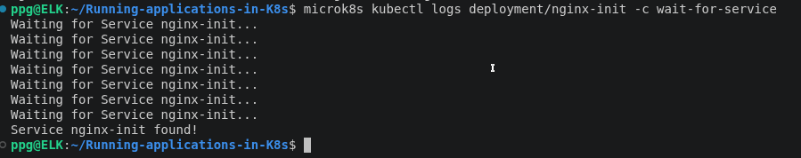

Из тестового Pod multitool-test выполнен HTTP-запрос к Service nginx-init. Ответ 200 OK подтверждает доступность приложения внутри кластера Kubernetes.

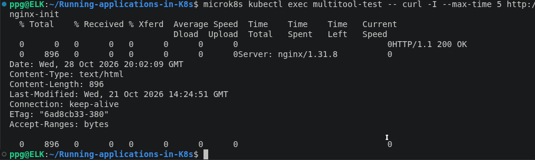

